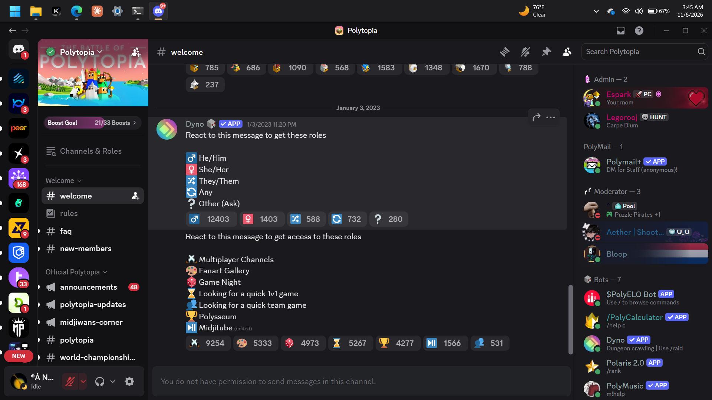
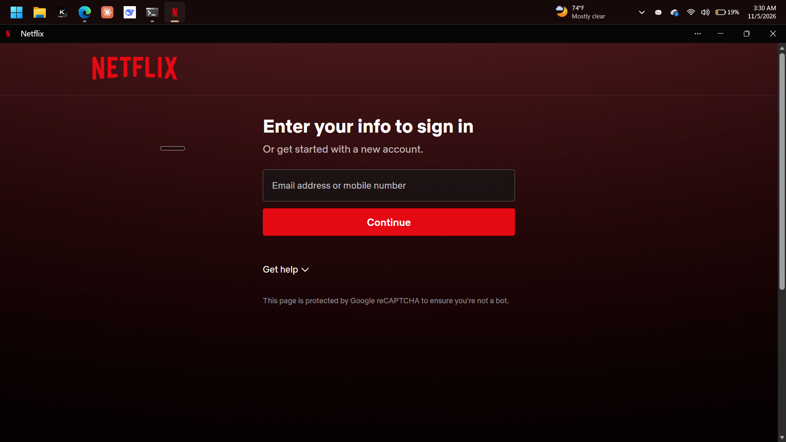
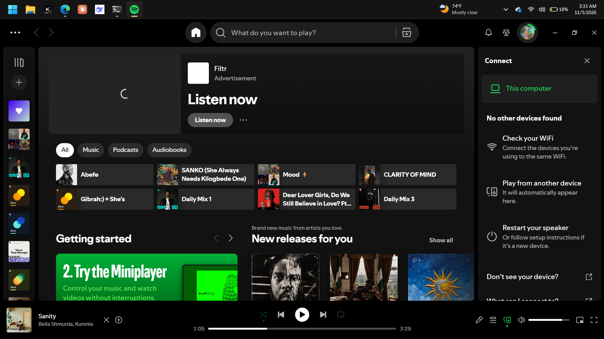

# ChromaTaskbar

**A Windows 11 taskbar that adapts its colour to the application you're using.**

ChromaTaskbar dynamically changes the taskbar colour based on the foreground maximized application. It runs quietly in the system tray and uses TranslucentTB to render the taskbar.

## Screenshots

| Discord | Netflix |
|---|---|
|  |  |

| Spotify | YouTube |
|---|---|
|  |  |

## Features

- Adapts to the foreground maximized application.
- Keeps the taskbar transparent on the desktop and Windows shell surfaces.
- Captures visible application content and samples a representative colour.
- Smooth colour transitions when switching applications.
- Runs quietly in the notification area.
- Preserves and restores original TranslucentTB settings.
- Does not save screenshots, send network traffic, inject into applications, or modify Explorer.

## Requirements

- Windows 11, 64-bit.
- TranslucentTB installed and running.
- No separate .NET runtime required; it is bundled with the release.

## Download and installation

Get the latest installer or portable package from the **[GitHub Releases](https://github.com/Orth0myxo/ChromaTaskbar/releases)** page.

### Installer

1. Download `ChromaTaskbar-Setup.exe`.
2. Run it and choose **Install**.
3. Launch ChromaTaskbar from the Start menu.

### Portable

1. Download `ChromaTaskbar-Portable.zip`.
2. Extract the archive.
3. Run `Run ChromaTaskbar.cmd`.

See [INSTALLATION.md](INSTALLATION.md) for further instructions.

## System tray controls

- **Double-click:** Open the diagnostic window.
- **Open Settings:** Open the diagnostic window from the tray menu.
- **Pause colour detection:** Stop sampling and restore original TranslucentTB settings.
- **Resume colour detection:** Restart monitoring.
- **Exit ChromaTaskbar:** Stop the application and restore original settings.

Closing the diagnostic window hides it to the tray; it does not exit the application.

## How it works

ChromaTaskbar monitors foreground-window changes using Windows accessibility events and a polling fallback. It accepts maximized foreground applications, captures visible window content using Windows GDI, analyzes pixels in memory, and smooths the resulting colour before updating TranslucentTB settings.

## Known limitations

- TranslucentTB must be installed and running.
- Protected, inaccessible, and some GPU-rendered windows may not capture successfully.
- Only the foreground maximized application controls the colour.
- Forced termination or a system crash can prevent normal settings restoration.

## License

MIT. See [LICENSE](LICENSE).

## Documentation

- [Features](FEATURES.md)
- [Installation and testing](INSTALLATION.md)
- [Troubleshooting](TROUBLESHOOTING.md)